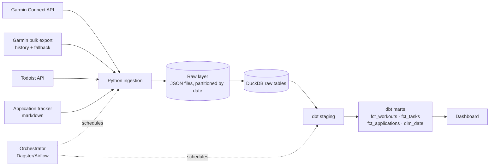

# Personal Data Platform

An end-to-end data platform over my own life data: fitness (Garmin), tasks (Todoist) and my job-search pipeline.
Built as a portfolio project to practice modern data engineering: ingestion → raw layer → dbt models → orchestration → dashboard.

## Architecture



## Stack
| Layer | Tool | Status |
|---|---|---|
| Ingestion | Python 3.12+ (developed on 3.13), `garminconnect` | M0 |
| Raw storage | JSON files → DuckDB | M0–M1 |
| Transformation | dbt (dbt-duckdb) | M2 |
| Orchestration | Dagster or Airflow | M3 |
| Dashboard + cloud | TBD | M4 |

## Design decisions
- **Local-first.** DuckDB on a laptop until the model is proven; one cloud provider in M4.
- **Raw is immutable.** Every API response lands as-is in `data/raw/<source>/<entity>/dt=YYYY-MM-DD.json`. Transformations never touch raw, so any model can be rebuilt from scratch.
- **Unstable source, planned fallback.** The Garmin API wrapper is unofficial and has broken before when Garmin changed auth. The official bulk export covers history and acts as a fallback.
- **Idempotent loads.** Re-running a day overwrites that day's partition; no duplicates.

## Repo layout
```
ingestion/      Python extractors, one module per source
data/raw/       landed raw JSON (gitignored)
dbt/            dbt project (M2)
docs/           notes and diagrams
```

## Quickstart
```bash
python -m venv .venv && source .venv/bin/activate   # Windows: .venv\Scripts\activate
pip install -r requirements.txt
cp .env.example .env                                  # fill in Garmin email/password and Todoist token
python -m ingestion.garmin --days 30                  # first run: interactive login (MFA if enabled)
python -m ingestion.todoist --days 30                 # snapshot of projects/tasks + completed tasks
```

## Milestones
- [ ] **M0** Repo, README, architecture; Garmin access; raw JSON landed
- [ ] **M1** Todoist + application-tracker ingestion; DuckDB raw tables
- [ ] **M2** dbt staging/marts + tests
- [ ] **M3** Orchestration schedule
- [ ] **M4** Dashboard + cloud migration
- [ ] **M5** (optional) Agent layer: MCP server over the warehouse (read-only SQL) + a scheduled weekly-review agent
